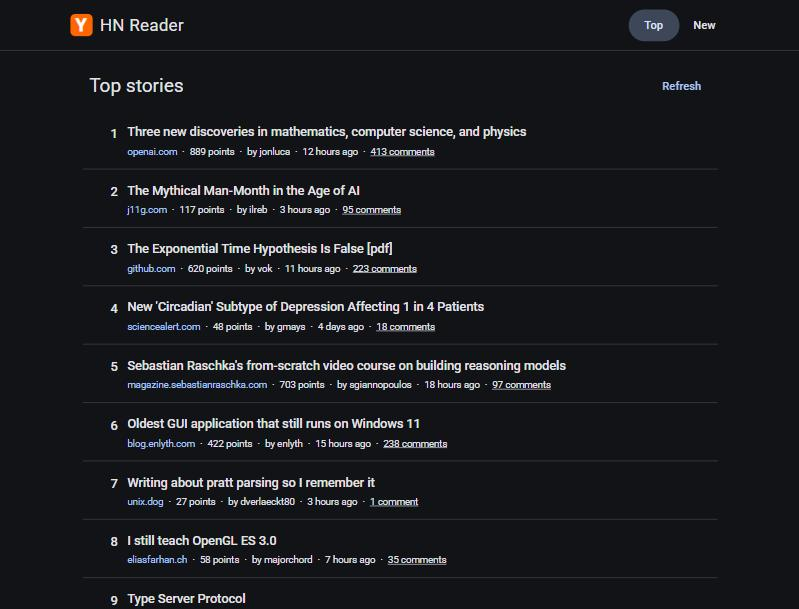

# HN Reader

A cleaner front page for Hacker News, built with Angular 22 on top of the official
[Hacker News API](https://github.com/HackerNews/API).



## Features

- **Top and New feeds**, switched from the header. Each feed has its own URL (`/top`, `/new`).
- **A clean, readable list**: rank, title, site, points, author, how long ago it was posted (hover
  for the exact date), and a link to the discussion.
- **Pagination through everything the API offers**, which is up to 500 stories per feed. You can
  choose **10, 20, 30 or 50 stories per page**. The page and the page size both live in the URL
  (`/new?page=3&size=50`), so refreshing, sharing a link and the browser's Back button all work.
  Switching between Top and New keeps your page size.
- **Jump straight to any page** with the "Page [5] of 17" list, as well as first, previous, next
  and last.
- **Refresh** to pick up the latest list without reloading the app.
- **Nothing jumps around while loading.** When you refresh or change page, the stories on screen
  stay where they are, faded, until the new ones are ready, so your scroll position holds.
- **Loading placeholders, and an error message with a "Try again" button** if the API can't be
  reached.
- **Light and dark mode.** It starts from your system setting, and the button in the header
  switches it and remembers your choice.
- **Accessible**: usable with a keyboard and a screen reader (details below), and works on
  phone-sized screens.

## Running it

You'll need Node.js 22.22+ or 24.15+.

```bash
npm ci          # install the exact versions from package-lock.json
npm start       # dev server on http://localhost:4200
npm test        # unit tests (Vitest), in watch mode
npm run coverage  # run the tests once with a coverage report
npm run lint    # ESLint with the Angular rules
npm run build   # production build into dist/
```

## How it works

### Structure

The code is grouped by feature, following the current Angular style guide:

```
src/app/
  hacker-news/   talking to the API: the HnItem model, the HackerNewsApi service, the retry interceptor
  feed/          the feed page and the row that shows one story
  shared/        app-wide pieces: error reporting, the light/dark theme, the time-ago and domain pipes
```

### Loading stories

The API has no paging of its own. `topstories.json` and `newstories.json` return up to 500 ids in
one go, and each story then has to be fetched by id. So the app:

1. Fetches the id list for the feed once.
2. Works out which ids belong to the current page.
3. Fetches just those stories, in parallel, and shows them in order.

All three steps sit behind one service call, `getPage(feed, page, pageSize)`, which also moves an
out-of-range page number back into range. The paging rules live in one place, tested on their
own, and the page component just displays the result.

The id list is kept for as long as you stay on that feed. Without this, a new story arriving
between page 1 and page 2 would push everything down one place, and you'd see the same story
twice. **Refresh** throws the list away and starts again. Stories that were already loaded are
cached too, so going back a page is instant.

### State

Components are standalone and keep their state in signals. The code relies on Angular 22's
defaults instead of repeating them: `OnPush` change detection, running without zone.js, and an
app-wide `HttpClient` are all on out of the box.

The feed page loads each page with a single `rxResource`, which gives loading and error states
for free. When the page changes, a resource normally drops its old value while the new one loads.
That would swap the list for placeholders, shrink the page and jump your scroll position. A
`linkedSignal` keeps the last page on screen until the next one arrives, a bit like "keep previous
data" in other data-fetching libraries.

The router passes the feed, the page number and the page size into the page as inputs
(`withComponentInputBinding`), so the URL is the single source of truth. A page number that's too
high, like `?page=99`, shows the last page. Anything that isn't a valid page number shows page 1,
and a page size that isn't one of the options falls back to 30.

### Where settings live

The API addresses are in `src/environments/`, because those would change between deployments,
for example to point at a mock or staging API. Behaviour settings like the request timeout, the
retry delays and the page sizes are named constants next to the code that uses them. They're the
same everywhere, the code reads better with them in place, and the tests import the same
constants. If they ever needed tuning without a rebuild, they would move to configuration loaded
at runtime, not to the build-time environment files.

### When things go wrong

Errors are never swallowed. Each one is retried if that can help, recorded for analysis, and
shown to the reader when it affects what they see.

**Retrying.** An HTTP interceptor gives every request a 10 second timeout and retries it twice,
waiting 300ms and then 600ms, but only when retrying can help: network errors, timeouts and 5xx
responses.

**Recording.** Every error goes to one `ErrorReporter`, which records it once with its source,
message, page, time and details such as the HTTP status and URL. Errors arrive there three ways:

- A second interceptor reports every request that still fails after the retries. It sits outside
  the retry interceptor, so a request that fails three times is one report, not three.
- The feed page reports any other error in loading a page. That would be a bug rather than a
  network problem.
- A custom `ErrorHandler` replaces Angular's default one, which only logs to the console, so
  uncaught errors anywhere in the app are reported too.

The same error can be caught by the HTTP layer and then again by the page, so the reporter
remembers what it has seen and records each error only once. For now reports go to the browser
console. `ErrorReporter.report()` is the one place to connect a service such as Sentry or Datadog.

**Telling the reader.**

- If the story list can't be loaded at all, the page says so and offers **Try again**.
- If only some stories fail, the rest are shown with a notice above the list: "2 stories couldn't
  be loaded. Try again". Screen readers hear it as part of the page status. The other stories keep
  their real ranks, so a missing story 5 doesn't turn story 6 into number 5. **Try again** only
  re-fetches what's missing, because loaded stories are cached.
- These are inline messages, not toasts. A toast disappears on its own, can cover the paginator,
  and is easy to miss. A notice next to the list it describes stays until the problem is fixed.

### UI

The UI uses Angular Material (toolbar, buttons, paginator and progress bar) rather than custom
widgets, so it gets accessible, well-tested components and a consistent theme. The feed page is
lazy-loaded, so it lives in its own bundle.

Light and dark mode come from the Material theme, which picks its colours from the page's
`color-scheme`. The theme button only has to change that one value, and it saves the choice in
`localStorage`. A few lines in `index.html` apply a saved choice before Angular starts, so a
dark-mode visitor doesn't see a white flash on load.

### Accessibility

- **Structure that assistive technology understands:** header, navigation, main and footer
  landmarks, one `h1` per page and an `h2` per story, and a real numbered list that starts from
  the right rank on every page. It has `role="list"` because Safari stops announcing lists whose
  bullets are hidden.
- **Keyboard:** everything is reachable and visibly focused. A **"Skip to stories"** link appears
  on the first Tab. After Next, Previous, First or Last, focus moves to the top of the new stories
  instead of staying on the paginator at the bottom. The page list is different: focus stays on it,
  because moving focus while someone is still choosing would be disorienting.
- **Page list:** a native `<select>`, so it works with every keyboard and screen reader and opens
  the phone's own picker on mobile. It's labelled "Page" and described as "of 17".
- **Screen readers:** a polite live region announces what's on screen ("Showing top stories 31
  to 60 of 500"), errors use `role="alert"`, and the list is marked `aria-busy` while it loads.
  The active feed is marked with `aria-current="page"`, and the icon-only theme button has a
  label.
- **Clear link names:** every comments link also says which story it belongs to, and links that
  open a new tab say so. The extra wording is only read out, so the visual design stays clean.
- **Comfort:** the colours come from Material's theme in both light and dark mode, the loading
  animation stops for people who prefer reduced motion, and the layout works at phone widths and
  when zoomed.

## Testing

There are 71 unit tests, with about 97% line coverage (`npm run coverage`):

- **API service:** URLs, reusing the id list, refresh, skipping missing and deleted stories,
  counting failed ones, the item cache, and `getPage` (the right slice, true ranks around a failed
  story, out-of-range pages, empty feeds), all using `HttpTestingController`.
- **Retry interceptor:** retries and their growing delays, timeouts, giving up, and not retrying
  4xx responses or non-GET requests, using fake timers.
- **Error reporting:** what a report contains, HTTP details, recording an error only once, a
  failed request reported once after all its retries (not on each attempt), errors still reaching
  the code that made the request, and the global error handler.
- **Feed page:** goes through the real routes with `RouterTestingHarness` and the real service,
  with only its network calls faked. It covers the first page, `?page=` and `?size=` in the URL,
  out-of-range values, the paginator and the page list updating the URL, focus after paging, the
  screen-reader announcement, a failed list and its retry, some stories failing (notice, true
  ranks, retry), reporting non-network errors, empty feeds, refresh, and stories staying on
  screen while a refresh loads.
- **Story row and pipes:** links for normal and text posts, the screen-reader text on links, the
  full date on hover, singular and plural labels, job posts, relative times and domains.
- **Theme and app shell:** starting from the system setting, a saved choice, switching and
  remembering, the fallback when the browser can't say, the header's links, the theme button and
  the skip link.

## Assumptions

- "Top" and "New" mean the API's `topstories` and `newstories` lists, at up to 500 stories each.
- 30 stories per page by default, the same as Hacker News itself, with 10, 20 and 50 as options.
- Paging works on the list as it was when the feed was opened, so positions can drift from the
  live site until you press Refresh.
- Deleted stories, dead (flagged) stories and ids that no longer return an item are hidden.
- Job posts appear in Top, as they do on Hacker News, but without points or comments.
- Comment threads were out of scope, so the comments link opens the discussion on
  news.ycombinator.com. Text posts like "Ask HN", which have no external link, open there too.
- The API is read-only, so there's no login, voting or posting.
- Relative times are in English, and the target is modern evergreen browsers.

## Trade-offs and what I'd do next

- **No server-side rendering.** It's a client-side app over a public API with no SEO requirement,
  so it can be hosted as static files. SSR would be the next step if search engines needed to index it.
- **The caches live in memory for the session**, and Refresh is the only way to clear them. That's
  fine for reading, but a long-lived tab could show old scores until refreshed.
- Next I'd add comment threads and the other feeds. Best, Ask, Show and Jobs would each need a
  value added to the `Feed` type, a title and a route, because the service and page already work
  off the feed name. I'd also add end-to-end tests with Playwright, and keyboard shortcuts for
  moving between pages.
